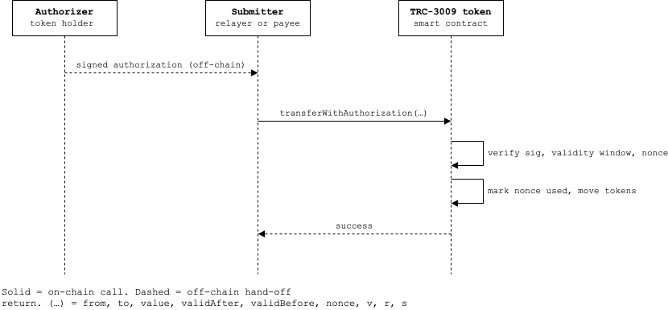

# TRON TRC-3009

Implementation Reference for TRC-3009, based on Open Zeppelin TRC3009 extension

## Overview

### What is TRC-3009 and Why its relevant for TRON?

TRC-3009 introduces a direct gasless token transfer primitive, it extends a TRC-20 contract functionality by letting a token holder authorize a transfer using an off-chain TIP-712 signature that any third party (e.g. a relayer) can submit on-chain and pay network fees for (the third party can still charge a fee in a different token, like USDT or USDD).
TRC-3009 mirrors ERC-3009 with no differences other than the underlying TIP-712 chainId difference compared to EVM chains (TRON:block.chainId & 0xffffffff vs EVM: block.chainId)

*Note: TRC-3009 extends TRC-20, meaning the contract (e.g. TRON USDT) must inherit TRC-3009 before users can benefit from it.*

TRC-3009 exposes the following functions:

- `transferWithAuthorization`: signature can be submitted by anyone, validAfter/validBefore time bounds and use random 32-byte nonces (not sequential), so they can be created and redeemed out of order / in parallel
- `receiveWithAuthorization` : binds the payee path and additionally requires to == msg.sender (mitigating front-running of the relayed call), validAfter/validBefore time bounds and use random 32-byte nonces (not sequential), so they can be created and redeemed out of order / in parallel
- `cancelAuthorization`: the Authorizer signs a cancel message for a nonce that is still unused, and that nonce becomes unusable. The cancel message is itself signature-based, so a relayer can submit it.

How a typical TRC-3009 token transfer flows:

1. A token holder (user) with no TRX to cover network fees signs an off-chain [TIP-712](https://github.com/tronprotocol/tips/blob/master/tip-712.md) compliant message (processed by a wallet).
2. A third party service provider (e.g. a relayer or gasless payment processor) executes `transferWithAuthorization` or `receiveWithAuthorization` in behalf of the user, usually taking a fee in stablecoin.
3. Transaction is broadcasted.



While other gasless primitives exist on TRON (permit (TIP-2612), permit2, TRC-2771), TRC-3009 offers key benefits such as narrowed down scope (TRC-20 extension, token transfers only), a random 32-byte nonce (better for high throughout payment flows without coordination ) ultimately deriving in reduced operational risks.

Below a comparative table across those primitives:

|                                    | Permit (TIP-2612)                       | Permit2                               | TRC-3009                                                                    | TRC-2771                                                                                 |
| ---------------------------------- | --------------------------------------- | ------------------------------------- | --------------------------------------------------------------------------- | ---------------------------------------------------------------------------------------- |
| **What the signature authorizes** | An allowance                            | An allowance, or one transfer         | One exact transfer                                                          | Any call, replayed by the forwarder as the signer                                        |
| **Scope**                         | Token approvals only                    | Token transfers only                  | Token transfers only                                                        | Any function on any recipient contract                                                   |
| **Transactions needed**           | 2                                       | 1, after a one-time `approve`       | 1                                                                           | 1, sent by the relayer to the forwarder                                                  |
| **Mechanism**                     | Token verifies the signature            | Separate Permit2 contract verifies it | Token verifies the signature                                                | Trusted forwarder verifies it, then appends the signer's 20-byte address to the calldata |
| **Signing format and nonce**      | Sequential nonce                        | Unordered bitmap                      | Random 32-byte nonce                                                        | Not defined by the spec; the forwarder decides                                           |
| **Trust assumption**              | Token only                              | Permit2 contract                      | Token only                                                                  | Recipient trusts the forwarder                                                           |
| **Works on existing tokens**      | No                                      | Yes                                   | No                                                                          | No; the contract must use `_msgSender()`                                               |
| **Cancel**                        | Consume the nonce                       | Invalidate the nonce                  | `cancelAuthorization`                                                     | Depends on the forwarder                                                                 |
| **Main risk**                     | Front-run griefing, leftover allowances | Permit2 is a single point of trust    | Leaked signature before expiry, unless `receiveWithAuthorization` is used | A malicious or upgradeable forwarder can forge the sender                                |

### Repo Layout

```
.
├── README.md                             # <-- you are here
├── assets                                # Repo misc assets (pngs, svgs, etc)
│   └── README                          
├── contracts                           
│   ├── Migrations.sol
│   └── TRC3009Token.sol                  # Implementation contract demo
├── migrations
│   ├── 1_initial_migration.js            # Tronbox Migration script
│   └── 2_deploy_contracts.js             # Deployment Script
├── package-lock.json
├── package.json                          # npm workspaces root (apps/*, packages/*)
├── sample-env
├── test
│   ├── MyTRC3009Token.test.js            # Test Suite script
├── tronbox-config.js                     # Tronbox config
└── utils
    └── trc3009_signature_script.js       #TRC-3009/TIP-712 signature generator 
```

### Getting Started

#### Pre-requisites

| Tool    | Version | Check with          | Needed for                                          |
| ------- | ------- | ------------------- | --------------------------------------------------- |
| Node    | ≥ 22   | `node -v`         | everything                                          |
| npm     | ≥ 10.9 | `npm -v`          | workspaces                                          |
| tronbox | ≥ 4.11 | `tronbox version` | compiling and deploying contracts                   |
| docker  | ≥ 28   | `docker version`  | tronbox runtime environment (local dev and testing) |

#### Step 1 — Install dependencies

```bash
git clone <this-repo>
cd tron-3009
npm install
```

#### Step 2 - Configure your TRC-3009 token

Adjust token name & token symbol in TRC3009token.sol contract per your needs

#### Step 3 - Compile contract

```bash
tronbox compile
```

#### Step 4 - Testing

```bash
docker pull tronbox/tre   #Pulls latest tronbox tre container (Make sure docker is running)
```

```bash
docker run -it -p 9090:9090 --rm --name tron tronbox/tre      #Runs the Tron Runtime environment 
```

```bash
tronbox test   #Deploys a test token in development network and runs basic test cases
```

```bash
tronbox test --network nile   #Deploys a test token in Nile and runs basic test cases (Requires a Nile account in your .env file)
```

### Manual Deployment and Test

Obtain Nile TRX at faucet: https://nileex.io/join/getJoinPage

#### transferWithAuthorization test

1. Setup your Nile account PK (⚠️Do not mix Nile & Mainnet private keys⚠️)

```bash
cd sample-env .env
nano .env   # Add your PK in PRIVATE_KEY_NILE 
```

2. Compile your contract

```bash
tronbox compile contracts/TRC3009Token.sol
```

3. Deploy your contract

```bash
tronbox deploy --network nile
```

4. Mint tokens towards authorizer account (your .env account by default)
5. Edit [signature_script](utils/trc3009_signature_script.js) signature script per your deployed contract address, network, "to" address, etc

```bash
nano utils/trc3009_signature_script.js
```

6. Execute the script

```bash
node utils/trc3009_signature_script.js
```

```
Expected output should be similar to:
```


```js
{
  from: 'TRONzjJSh5eC8WezVtnDXDuWXAwjV23e7',
  to: 'TRON5NN49YEGFNpDQZUXpViJ8B4c2BmL7e',
  value: '1000000000000000000',
  validAfter: 1779839907,
  validBefore: 1779843507,
  nonce: '0xa10bbd335660e9864d2bf69bd4bc3d09a154b93ac480946c0b673d938c5db80e',
  v: 27,
  r: '0xc031622e300e985d2e4159d188e4e890d5fc0f09ccae64e2bb4ea406b4df1849',
  s: '0x164bd21e436727ac6640d58ad5b4047097fff15c49d569a7a9f6ea852be4fd34'
}
```

7. Execute transferWithAuthorization in tronscan or tronbox console using the output from step 6

TRON TRC-3009 is being tracked here, for status tracking https://github.com/tronprotocol/tips/issues/883

This is by no means production-ready, proceed with caution and perform all necesary testing and audits before using in production.

#### Next Steps

- Implement the message signature flow within a dApp environment
- When executing agentic related flows in a desktop environment prefer Agentic Wallets (e.g. [agent-wallet](https://github.com/BofAI/agent-wallet)) over .env plain text PKs
- Token issuer entities should consider enabling TRC-3009 into their TRC-20 tokens to bring native gasless experiences for users and integrators alike.
